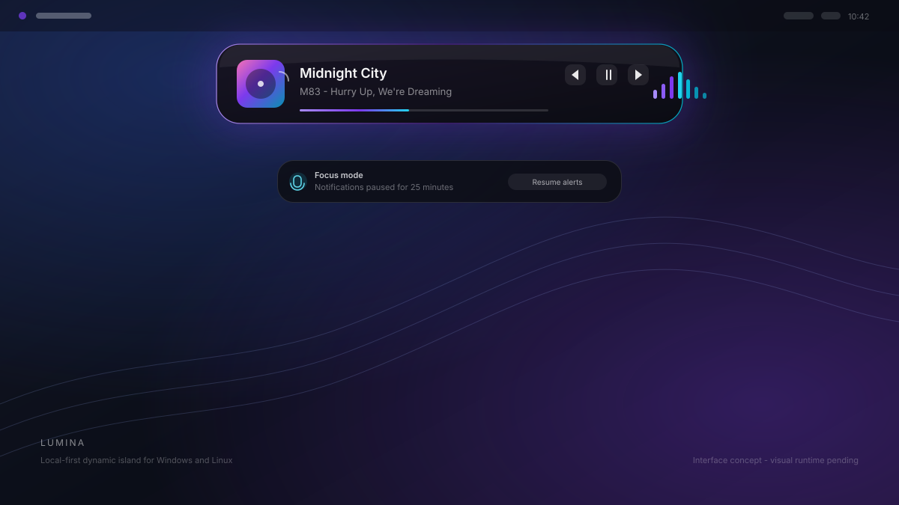

<p align="center">
  
</p>

<h1 align="center">Lumina</h1>

<p align="center">
  A local-first dynamic island for Windows and Linux.<br>
  Fast, keyboard friendly, deeply customizable, and quiet by default.
</p>

<p align="center">
  <strong>Status: V0.1.0-Alpha in release preparation.</strong><br>
  The engine libraries and headless tooling are tested. The visual orchestrator
  is the remaining runtime milestone.
</p>

<p align="center">
  
  <br>
  <sub>Design concept. The current alpha exposes the tested engine through a
  headless binary; visual runtime wiring is still in progress.</sub>
</p>

## Why Lumina

Lumina is a compact overlay that expands when something deserves attention and
collapses when it does not. It is built around four rules:

- **Local first.** No account, no telemetry, no auto-update, no listening network
  port. The optional weather widget is the only feature that makes a request.
- **Legible at a glance.** A priority arbiter decides what the island shows, so
  notifications, media, and system status never fight for the same pixels.
- **Yours to shape.** Every color, dimension, animation, widget, shortcut, and
  hotkey is configuration. Themes and profiles can be layered and inherited.
- **Cheap when idle.** The render loop is dirty-flag driven, text layout is
  cached, and the idle frame path is covered by a zero-allocation test.

## Current status

| Area | Status |
|---|---|
| Configuration schema, validation, repair, themes, profiles, hot reload | Implemented and tested |
| SDF geometry, springs, island state machine, priority arbiter | Implemented and tested |
| Color engines, WCAG contrast clamp, OkLab transitions | Implemented and tested |
| Text shaping, layout cache, atlas integration | Implemented and tested |
| Widget framework, layout, input routing, widget modules | Implemented and tested |
| Media and audio analysis libraries | Implemented and tested |
| Windows, X11, Wayland platform helpers | Implemented and tested headlessly |
| Renderer, WGSL pipelines, dirty-flag frame loop | Implemented and tested headlessly |
| IPC protocol, server, Python and Node clients | Implemented and tested |
| CLI diagnostics, self-test, benchmarks, baseline comparison | Implemented and tested |
| Live window and runtime orchestrator | In progress |
| Installer artifacts and published release | Packaging defined; release gate open |

The distinction matters. The repository is not an empty prototype: the engine
pieces exist and pass their tests. It is also not yet a daily-driver desktop
application, because the orchestrator that owns the window, event loop, media
and audio threads, and IPC lifecycle is not wired.

## Build from source

Requirements:

- Rust 1.85 or newer; `rust-toolchain.toml` selects the stable channel and CI
  checks the 1.85 MSRV
- Windows 10 1809 or newer, or a modern Linux distribution
- Linux: `pkg-config`, PulseAudio development headers, and a Vulkan or OpenGL
  driver. X11 and Wayland client libraries are needed for the platform
  backends.

```sh
git clone https://github.com/lumina-sh/lumina.git
cd lumina
cargo build --release --locked -p lumina-app -p lumina-ipc
```

On Windows PowerShell:

```powershell
cargo build --release --locked -p lumina-app -p lumina-ipc
.\target\release\lumina.exe --self-test
.\target\release\lumina.exe --diagnostics
```

On Linux:

```sh
cargo build --release --locked -p lumina-app -p lumina-ipc
./target/release/lumina --self-test
./target/release/lumina --diagnostics
```

Packaging definitions live in [`packaging/`](packaging/README.md). The scripts
produce MSI, NSIS, portable ZIP, deb, rpm, apk, and AppImage variants after the
release checklist passes. No artifact is published until the runtime gate is
complete.

## Command line

| Command | Purpose |
|---|---|
| `lumina --version` | Version, crate versions, and target triple |
| `lumina --check-config` | Parse, validate, and repair `config.toml` |
| `lumina --config PATH --check-config` | Validate a specific configuration file |
| `lumina --init-config [PATH]` | Write the annotated default configuration |
| `lumina --print-config` | Print the default configuration to stdout |
| `lumina --list-themes` | List built-in and user themes |
| `lumina --export-theme NAME [--output PATH]` | Export a theme as TOML |
| `lumina --check-theme PATH` | Apply and validate a theme file |
| `lumina --diagnostics` | Environment dump designed for bug reports |
| `lumina --self-test` | Exercise headless subsystem checks |
| `lumina --benchmark` | Record CPU benchmarks as JSON |
| `lumina --benchmark --baseline perf/baseline-windows.json` | Compare against a saved baseline |
| `lumina --autostart install` | Manage the per-user autostart entry |
| `lumina-send status` | Query a running instance over local IPC |

Exit code `0` means success, `1` means a validation, self-test, or benchmark
failure, and `2` means a command line error.

## Configuration

Lumina installs an annotated `config.toml` with every key and its default. Delete
a line to return that key to its compiled default. Unknown keys produce a
warning with a spelling suggestion; invalid values are repaired one key at a
time instead of discarding the whole file.

```toml
[appearance]
fill = "#12121ACC"
corner_radius = 18.0
height = 36.0

[rgb]
mode = "breathing"
primary = "#7C3AED"
secondary = "#06B6D4"

[accessibility]
enforce_contrast = true
contrast_target = 4.5
screen_reader = "auto"
```

- Full generated reference: [`docs/configuration.md`](docs/configuration.md)
- Theme authoring and eight examples: [`docs/themes.md`](docs/themes.md)
- Script widget security model: [`docs/script-widget.md`](docs/script-widget.md)
- Accessibility model: [`docs/accessibility.md`](docs/accessibility.md)
- Editor and automation protocol: [`docs/ipc.md`](docs/ipc.md)

Values merge from compiled defaults, then the base config, active theme, active
profile, command line, and session-only IPC changes. Later layers win.

## IPC and integrations

Lumina exposes one newline-delimited JSON control surface over a per-user Unix
socket or Windows named pipe. It supports 19 commands, 5 events, 11 stable error
codes, rate limiting, and up to 8 concurrent clients.

```sh
lumina-send notify --title "Build done" --body "All checks passed"
lumina-send media --action play_pause
lumina-send set_rgb --mode reactive --color "#FF9500"
```

Python and Node clients live in [`clients/`](clients/). The protocol is described
in [`docs/ipc.md`](docs/ipc.md), and the client contract is covered by tests.

## Privacy

Lumina has no telemetry, no analytics, no crash upload, no account system, and no
auto-update channel. It opens no listening network socket. The control socket or
named pipe is local to the current user. Logs are local and are designed not to
contain media paths or notification bodies.

The optional weather widget is the only network client. When disabled, Lumina
makes no network requests. Shortcuts, scripts, and the `execute` IPC command run
local programs because the user configured them; they are not sandboxed, and the
documentation says so plainly.

## Accessibility

- WCAG contrast is enforced across every RGB mode and brightness value.
- A force-enabled keyboard focus ring supports Tab, Shift+Tab, Enter, Space, and
  Escape.
- Reduced motion follows the operating system and can be overridden.
- A bundled high-contrast theme targets a 7.0 contrast ratio.
- Screen-reader mirroring exists through platform notifications; the runtime
  event hookup is part of the orchestrator milestone.
- Minimum text size, DPI scaling, and non-color status indicators are validated
  by tests.

See [`docs/accessibility.md`](docs/accessibility.md) for the full model.

## Architecture

The workspace is split so rendering can be tested without a window, IPC can be
tested without an app, and configuration can be tested without a GPU:

```text
lumina-app
  |-- lumina-config ---- lumina-core
  |-- lumina-render ---- lumina-config, lumina-core
  |-- lumina-widgets --- lumina-config, lumina-core, lumina-text, lumina-media
  |-- lumina-platform -- lumina-config, lumina-core
  |-- lumina-text ------ lumina-core
  |-- lumina-color ----- lumina-core
  |-- lumina-audio ----- lumina-config, lumina-core
  |-- lumina-media ----- lumina-core
  `-- lumina-ipc ------- (no UI dependencies)
```

Read [`docs/architecture.md`](docs/architecture.md) for the state machine, shape
math, render passes, animation model, threading, and panic policy. If something
misbehaves, start with [`docs/troubleshooting.md`](docs/troubleshooting.md).

## Quality gates

```sh
cargo fmt --all --check
cargo clippy --workspace --all-targets --all-features
cargo test --workspace --all-targets -- --test-threads=4
cargo test --workspace --doc
cargo run -p lumina-app -- --self-test
cargo xtask docs --check
cargo xtask release-check
```

The self-test and benchmark suites run without a display. CI also validates
shaders through `naga`, checks supply-chain policy with `cargo-deny`, tests the
MSRV, and runs the IPC and configuration-doc drift checks.

## Repository layout

| Path | Contents |
|---|---|
| `crates/` | Engine, platform, renderer, widgets, configuration, IPC, and app binary |
| `clients/` | Python and Node clients |
| `docs/` | User, integrator, architecture, release, and troubleshooting guides |
| `packaging/` | Windows and Linux installer definitions and completions |
| `perf/` | Benchmark procedure and committed baselines |
| `xtask/` | Generated documentation and release verification |

## Versioning

Lumina follows semantic versioning. Configuration schema changes are versioned
separately and must provide a repair path. Pre-release artifacts use identifiers
such as `0.1.0-alpha.1`; installer versions map them to numeric MSI versions.

See [`CHANGELOG.md`](CHANGELOG.md) and
[`docs/release-checklist.md`](docs/release-checklist.md).

## License

MIT. See [`LICENSE`](LICENSE).
